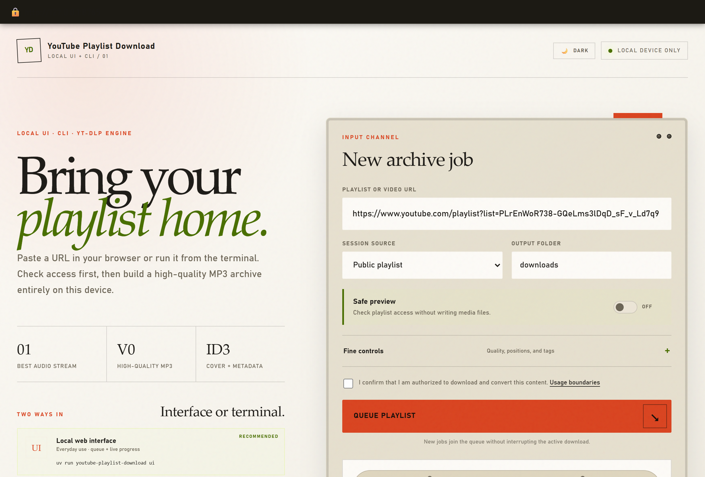

# YouTube Playlist Downloader & Archiver

[](https://github.com/tahsinsoyak/youtube-playlist-download/actions/workflows/ci.yml)
[](https://www.python.org/)
[](LICENSE)
[](https://github.com/yt-dlp/yt-dlp)
[](https://github.com/astral-sh/ruff)
[](https://pypi.org/project/youtube-playlist-download/)
[](https://www.patreon.com/tahsinsoyak)

Fast, lightweight local Web UI & CLI to archive **public, unlisted, and private YouTube playlists** as high-quality **MP3, M4A, or Opus** audio files with metadata and album art.

<p align="center">
  
</p>

---

## ⚡ Quick Start

### 1. Prerequisites (Windows PowerShell)
```powershell
winget install Gyan.FFmpeg DenoLand.Deno
```
*(Requires Python 3.11+ and [uv](https://docs.astral.sh/uv/))*

### 2. Install & Run

#### Option A: Instant run with uvx (Zero install)
```powershell
uvx youtube-playlist-download ui
```

#### Option B: Install with pip
```powershell
pip install youtube-playlist-download
youtube-playlist-download ui
```

#### Option C: Clone & run (or double-click `run.bat` on Windows)
```powershell
git clone https://github.com/tahsinsoyak/youtube-playlist-download.git
cd youtube-playlist-download
uv run youtube-playlist-download ui
```

Your browser will automatically open at `http://127.0.0.1:8765`.

---

## 🔒 Private Playlists (Liked Videos, Watch Later)

Download your private and unlisted playlists safely on your own machine:

1. **Sign in to YouTube** in your browser (*Firefox recommended on Windows*).
2. **Select your browser** in the Web UI session dropdown.
3. **Paste URL & download** — in-memory session access only, zero cookies on disk, 100% localhost.

> [!TIP]
> **Windows Tip:** Chromium browsers (Chrome, Edge, Brave) lock their cookie databases while open. Close all Chrome/Edge windows first, or simply use Firefox.

---

## 🖥️ Command-Line Interface (CLI)

Prefer the terminal? Run downloads directly:

```powershell
# Public playlist (MP3, best quality)
uv run youtube-playlist-download download "PLAYLIST_URL" --confirm-rights

# Private playlist via Firefox session
uv run youtube-playlist-download download "PLAYLIST_URL" --browser firefox --confirm-rights

# Specific tracks & format (Opus, items 1 to 10)
uv run youtube-playlist-download download "PLAYLIST_URL" --audio-format opus --playlist-items "1:10" --confirm-rights
```

---

## ✨ Highlights

* **Local Web UI & CLI**: Zero heavy build steps; runs on pure HTML5/CSS3/ES6 and fast Typer CLI.
* **Dark & Light Themes**: Tactile cassette-deck dark mode and crisp studio light paper mode.
* **Folder Reveal & Copy Path**: One-click button in the UI to open downloaded folders or copy the path.
* **Sequential Queue**: FIFO queue processes one playlist at a time to prevent YouTube rate-limiting.
* **Smart History & Clean-up**: Review recent download outcomes and clear history with one click.
* **Audiophile Audio & Tags**: High-quality VBR encoding, embedded ID3 tags, and album cover art.
* **Duplicate Prevention**: Automated download archive (`.playlist-audio-archive.txt`) skips existing tracks.
* **Crash Resilience**: Queue state persists locally across app restarts.

---

## 📚 Documentation

* [CLI Options & Advanced Usage](docs/usage.md)
* [Web UI Guide](docs/web-ui.md)
* [Private Playlists & Troubleshooting](docs/private-playlists.md)
* [Audio Quality & Codecs](docs/audio-quality.md)
* [Legal & Fair-Use Boundaries](docs/legal-and-ethics.md)

---

## ⭐ Star History

If this project helps you, please consider giving it a star on GitHub!

<p align="center">
  <a href="https://star-history.com/#tahsinsoyak/youtube-playlist-download&Date" target="_blank" rel="noopener noreferrer">
    
  </a>
</p>

---

## 💖 Support the Project

If this project helps you archive and organize your music library, consider supporting ongoing maintenance and updates:

<p align="center">
  <a href="https://www.patreon.com/tahsinsoyak" target="_blank" rel="noopener noreferrer">
    
  </a>
</p>

---

## 📄 License

MIT License. See [LICENSE](LICENSE) for details.
