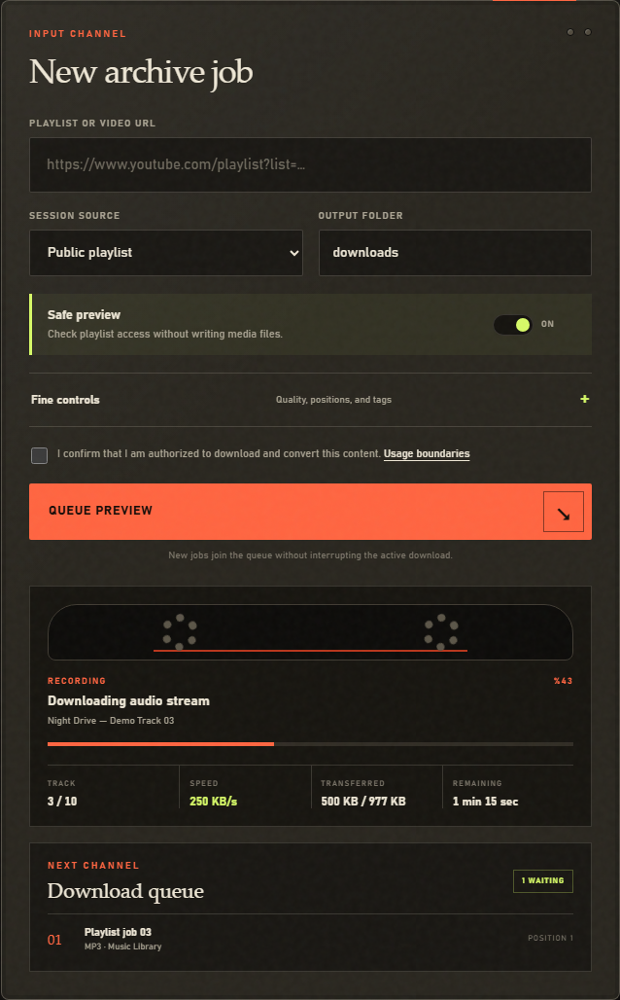
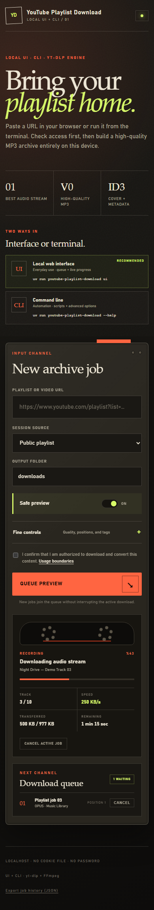

# YouTube Playlist Downloader & Archiver

[](https://github.com/tahsinsoyak/youtube-playlist-download/actions/workflows/ci.yml)
[](https://www.python.org/)
[](LICENSE)
[](https://github.com/yt-dlp/yt-dlp)
[](https://github.com/astral-sh/ruff)

A fast, lightweight localhost web UI and CLI powered by [`yt-dlp`](https://github.com/yt-dlp/yt-dlp) to archive **public, unlisted, and private YouTube playlists** as high-quality **MP3, M4A, or Opus** audio files with embedded metadata and artwork.

> [!IMPORTANT]
> This project is designed for personal archiving and is not intended to bypass copyright restrictions. Use it only for content you own, have explicit permission from the rights holder to download, or may lawfully download under applicable fair-use or local legislation.

---

## See it in action


<p align="center">
  
  
</p>

---

## 🔒 Downloading Private Playlists (Made Simple & Secure)

Most online YouTube downloaders **fail on private playlists** (such as your "Liked Videos", "Watch Later", unlisted mixes, or member-only playlists) because they require an authenticated session. Asking users to enter Google passwords or upload exported `cookies.txt` files to third-party web servers creates a severe security risk.

### Why this tool is 100% safe for private content:
* **Strict Loopback Binding (`127.0.0.1`):** The app runs exclusively on your local machine. Nothing ever leaves your device.
* **No Passwords or Secret Keys:** The tool never prompts for your Google account password.
* **No Insecure Cookie Files:** It leverages `yt-dlp`'s secure local browser session integration in-memory; no cookie files are ever written to disk or sent to external servers.

### 3-Step Guide to Download a Private Playlist:
1. **Sign in to YouTube** in your browser (Firefox is recommended for seamless access on Windows).
2. **Start the local Web UI:**
   ```powershell
   uv run youtube-playlist-download ui
   ```
3. **Paste your private playlist URL**, select your browser session (`Firefox` or a closed `Chrome`/`Edge` instance), check *Confirm rights*, and click **Start safe preview**. Once validated, click **Download MP3**!

> [!TIP]
> **Windows Chromium Tip:** Windows exclusively locks the cookie database of Chromium browsers (Chrome, Edge, Brave, Opera) while they are running. To use a Chrome session, either close all Chrome windows/processes first or simply sign into YouTube with Firefox.

---

## ⚡ Quick Start

### Prerequisites
* **Python 3.11+**
* **[FFmpeg](https://ffmpeg.org/download.html)** (for audio conversion and metadata tagging)
* **[Deno 2.3+](https://docs.deno.com/runtime/getting_started/installation/)** (recommended) or **Node.js 22+** (required by modern `yt-dlp` to deobfuscate YouTube signatures)
* **[uv](https://docs.astral.sh/uv/)** (recommended for fast, reproducible Python setup)

### Installation (Windows PowerShell)

```powershell
# 1. Install system prerequisites (if not already installed)
winget install Gyan.FFmpeg
winget install DenoLand.Deno

# 2. Clone the repository
git clone https://github.com/tahsinsoyak/youtube-playlist-download.git
cd youtube-playlist-download

# 3. Synchronize virtual environment
uv sync --locked

# 4. Verify your environment setup
uv run youtube-playlist-download doctor

# 5. Launch the local Web UI
uv run youtube-playlist-download ui
```

Your browser will automatically open at `http://127.0.0.1:8765`.

---

## 🖥️ Command-Line Interface (CLI)

Prefer the terminal? The CLI supports public and private playlists, safe dry-runs, item range filters, and batch queueing:

### Public or Unlisted Playlists
```powershell
# Safe preview (check track count, access, and names without downloading)
uv run youtube-playlist-download download "PLAYLIST_URL" --dry-run --confirm-rights

# Download full playlist as best-quality MP3
uv run youtube-playlist-download download "PLAYLIST_URL" --confirm-rights
```

### Private Playlists (via Firefox session)
```powershell
uv run youtube-playlist-download download "PLAYLIST_URL" `
  --browser firefox `
  --confirm-rights
```

### Advanced Options
```powershell
# Specific audio format (mp3, m4a, opus) and item range (e.g. tracks 1 to 10)
uv run youtube-playlist-download download "PLAYLIST_URL" `
  --audio-format opus `
  --playlist-items "1:10" `
  --output "C:\Music\MyPlaylists" `
  --confirm-rights
```

By default, files are organized into `downloads/<playlist_title>/001 - Title [ID].mp3`.

---

## ✨ Features at a Glance

| Feature | Description |
|---|---|
| **Zero-Framework Web UI** | Pure, lightweight HTML5/CSS3/ES6 interface—no heavy Node build steps or frontend bundles. |
| **Sequential FIFO Queue** | Add new playlists while a download is running. One download processes at a time to prevent YouTube rate-limiting. |
| **Live Diagnostics** | Real-time transfer speed (KB/s), downloaded megabytes, current track position, and dynamic ETA calculations. |
| **Instant Cancellation & Retry** | Cancel queued or active jobs immediately—even during the metadata discovery phase—and retry with one click. |
| **Audiophile Quality** | Extracts highest available audio stream converted with FFmpeg VBR quality `0` (or pristine Opus/M4A). |
| **Metadata & Cover Art** | Automatically embeds track titles, artist names, album info, and high-resolution thumbnail art. |
| **Duplicate Prevention** | Maintains an automated download archive (`.playlist-audio-archive.txt`) so re-running playlists skips already downloaded tracks. |
| **Crash & Restart Persistence** | Queue state and history are persisted locally (`~/.playlist-audio/queue-state.json`) and restored automatically across restarts. |
| **Dependency Doctor** | Built-in `doctor` command inspects Python, `yt-dlp`, JavaScript runtimes, and FFmpeg/ffprobe readiness before downloading. |

---

## 🔄 Keeping `yt-dlp` Updated

YouTube changes its internal player code and signatures frequently. This repository uses a locked, tested `yt-dlp` release with automated Dependabot daily updates. To immediately upgrade your local dependencies:

```powershell
uv lock --upgrade-package yt-dlp
uv sync --locked
```

---

## 📚 Documentation & Guides

* [Usage and CLI Options](docs/usage.md)
* [Local Web Interface Guide](docs/web-ui.md)
* [Private Playlist Access & Troubleshooting](docs/private-playlists.md)
* [Audio Quality & Codecs Explained](docs/audio-quality.md)
* [Troubleshooting Common Issues](docs/troubleshooting.md)
* [Legal & Ethical Boundaries](docs/legal-and-ethics.md)
* [Architecture & Development Details](docs/architecture.md)

---

## 📄 License

This project is licensed under the [MIT License](LICENSE). Third-party tools including `yt-dlp` and FFmpeg retain their respective licenses.
